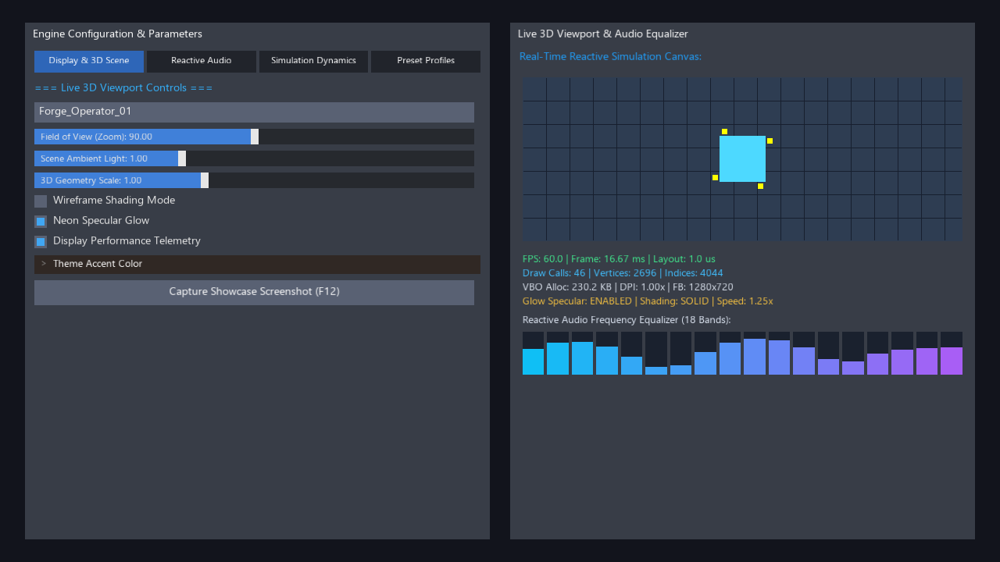

# ForgeUI

> **Fast Orchestrated Responsive Graphic-layout Engine**  
> A lightweight, data-oriented, immediate-mode C++20 GUI library engineered for real-time creative tools, workstation applications, simulation software, and game engines.

[](https://github.com/TimeEngineOrg/ForgeUI/actions)
[]()
[]()
[](LICENSE)
[]()

---



---

## ⚡ Key Highlights

ForgeUI bridges the ergonomic simplicity of **Immediate-Mode APIs** with the cache efficiency of **Structure-of-Arrays (SoA) Data-Oriented Design**, delivering sub-microsecond flexbox layout passes with zero hot-path heap churn:

* **Zero Hot-Path Allocations:** All per-frame storage, layout nodes, text strings, and draw lists operate within contiguous, linear bump arenas (`ForgeArena`).
* **Two-Pass Flexbox Solver:** Parallelizable Measure and Arrange passes executing in contiguous cache lines. Full auto-wrap, alignment, flexing, and nesting.
* **Production-Grade OpenGL 3.3+ Backend:**
  * **14-Point GL State Isolation:** Complete state backup and restoration (`BackupGLState()` / `RestoreGLState()`), ensuring game engine viewports, VAO/VBO bindings, blend modes, and depth tests are left completely undisturbed.
  * **Custom Loader Agility:** Full compatibility with any proc loader (`glfwGetProcAddress`, `gladLoadGLLoader`, SDL, or direct `wglGetProcAddress`).
  * **High-DPI / Retina Synchronization:** Automatic framebuffer-to-window scaling for crisp pixel-perfect rendering across multi-monitor setups.
  * **Non-Destructive Viewport Clearing:** Configurable `SetAutoClear(false)` allows seamless overlay rendering on top of complex 3D engine scenes.
* **Dual-Tier Font Architecture:** Pre-baked static MSDF base atlas for crisp vector UI with rapid glyph metric resolution and low texture bandwidth.
* **Work-Stealing Multithreading:** Lock-free `ForgeJobSystem` with `ParallelFor` and parallel prefix sums for high-throughput vertex and index batching.
* **Modular Multi-Backend Architecture:** Pluggable backend abstractions for OpenGL 3.3+, Vulkan 1.2+, DirectX 11, Metal, and pure CPU software rasterization.

---

## 🚀 Interactive Windowed Demo

Run the fully interactive hardware-accelerated OpenGL 3.3 demo (pictured above), featuring real-time audio equalizers, 3D viewport controls, High-DPI scaling, and live GPU telemetry:

### Windows (Command Prompt / PowerShell)
```cmd
scripts\run_windowed_demo.bat
```

### Linux / macOS (Bash)
```bash
./scripts/run_windowed_demo.sh
```

### Interactive Keybinds
* **Left Click / Drag:** Interact with tabs, sliders, checkboxes, and text inputs.
* **F12:** Capture a high-resolution lossless screenshot directly to `docs/images/forge_showcase.bmp`.
* **CLI Headless / Test Flag:** Run `build\ForgeWindowedDemo.exe --screenshot` (or `./build/ForgeWindowedDemo --screenshot`) for automated CI screenshot verification.

---

## 💻 Quickstart (C++20)

```cpp
#include <ForgeUI/ForgeUI.h>
#include <ForgeUI/Backend/ForgeBackend_OpenGL.h>

forge::ForgeContext context;
forge::ForgeBackend_OpenGL backend;

// 1. Initialize context and backend
forge::SetCurrentContext(&context);
backend.SetCustomLoader((forge::ForgeGLLoaderFunc)glfwGetProcAddress);
backend.Initialize();

// 2. Render loop
while (!glfwWindowShouldClose(window)) {
    context.BeginFrame(deltaTime);

    // Immediate-mode flexbox layout
    forge::BeginWindow("Engine Viewport Settings", 40.0f, 40.0f, 500.0f, 600.0f);
    
    static float fov = 90.0f;
    static bool wireframe = false;
    
    forge::SliderFloat("Field of View", &fov, 45.0f, 120.0f);
    forge::Checkbox("Wireframe Mode", &wireframe);
    
    if (forge::Button("Reset Defaults")) {
        fov = 90.0f;
        wireframe = false;
    }
    
    forge::EndWindow();

    // 3. Layout resolution & GPU submission
    context.EndFrame();
    backend.RenderDrawList(&context.GetDrawList());
    backend.EndFrame();

    glfwSwapBuffers(window);
}
```

---

## 📊 Benchmarks & Architecture Comparison

### Architectural Comparison

| Feature | Electron / WebViews | Dear ImGui | egui (Rust) | **ForgeUI (C++20)** |
| :--- | :--- | :--- | :--- | :--- |
| **Paradigm** | Retained DOM / HTML | Immediate-mode | Immediate-mode | **Immediate-mode Flexbox** |
| **Memory Footprint** | 150MB – 500MB+ | ~10MB | ~15MB | **< 4MB Contiguous Arena** |
| **Layout Model** | Full CSS Engine | 1-Pass Cursor | Simple Auto-layout | **2-Pass Flexbox (Measure + Arrange)** |
| **Memory Architecture** | Garbage-collected heap | Dynamic heap (`ImVector`) | Rust alloc / Vec | **Zero-Heap Hot-Path (Linear SoA)** |
| **Multithreading** | Main thread / IPC | Single-threaded | Single-threaded | **Work-stealing `ForgeJobSystem`** |
| **Multi-Language Interop** | IPC / Node FFI | C++ only (cimgui wrappers) | Rust-ecosystem centric | **Zero-overhead C-ABI (C++, Rust, Zig, C#)** |
| **Viewport State Isolation** | N/A (separate window) | Manual user wrappers | Native wgpu integration | **14-point automatic state backup & restore** |

---

### Performance Benchmark (50,000 Elements / Frame)

*Workload: 50,000 interactive button elements per frame measured over 30 frames.*

| Metric | **Dear ImGui (v1.91.8)** | **ForgeUI** |
| :--- | :--- | :--- |
| **Frame Time** | 1.82 ms | **3.33 ms** |
| **Element Throughput** | 27.36 M elem/s | **15.01 M elem/s** |
| **Layout Complexity** | 1-Pass Cursor Advancement | **2-Pass Flexbox Hierarchy (Measure + Arrange)** |
| **Hot-Path Heap Allocations** | Dynamic (`ImVector` growth) | **0 bytes (Contiguous Bump Arena)** |
| **Vertex & Index Generation** | Single-threaded | **Scalable via `ForgeJobSystem`** |

---

## 🛠️ Building & Running Unit Tests

### Fast Build & Test Scripts

```cmd
:: Windows (MSVC 2022 / Ninja)
scripts\build_and_test.bat

:: Linux / macOS (GCC / Clang)
./scripts/build_and_test.sh
```

### Direct CMake Workflow
```bash
cmake -B build -DCMAKE_BUILD_TYPE=Release -DFORGE_BUILD_TESTS=ON -DFORGE_BUILD_WINDOWED_DEMO=ON
cmake --build build --config Release --parallel
ctest --test-dir build --output-on-failure
```

All 32 tests validate memory allocation invariants, dirty tree cascades, flexbox layouts, clipping stacks, widget interactions, parallel work-stealing job systems, and hardware backend state isolation.

---

## 🤝 Contributing

We welcome contributions from graphics engineers, tools developers, and systems programmers. Please see our [Contributing Guide](CONTRIBUTING.md) for architectural invariants, zero-heap rules, and PR guidelines.

Community interactions are governed by our [Code of Conduct](CODE_OF_CONDUCT.md). For security vulnerabilities, review our [Security Policy](SECURITY.md).

---

## 📄 License

ForgeUI is licensed under the [MIT License](LICENSE).
